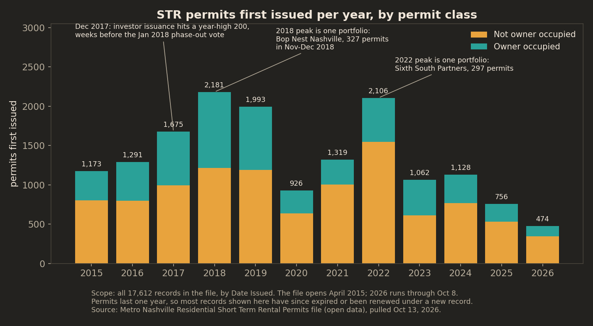
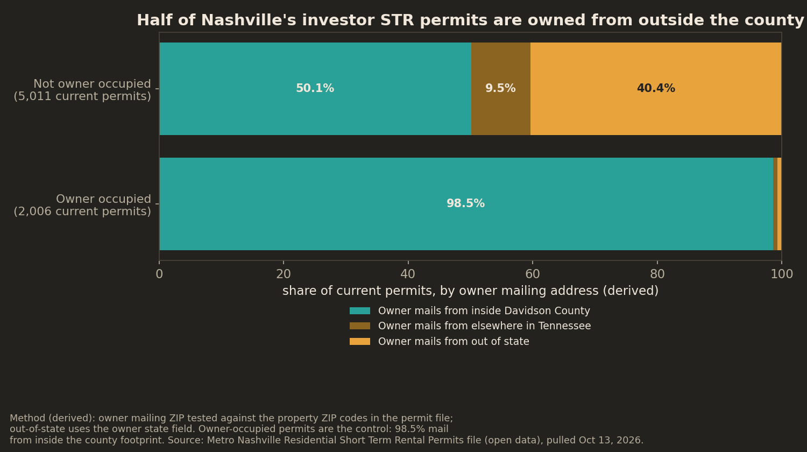
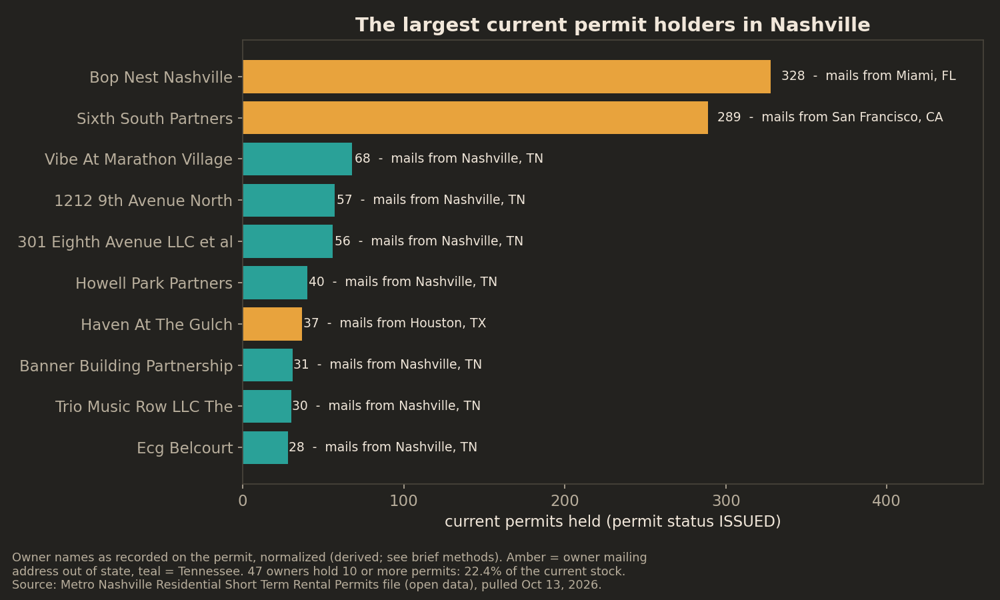
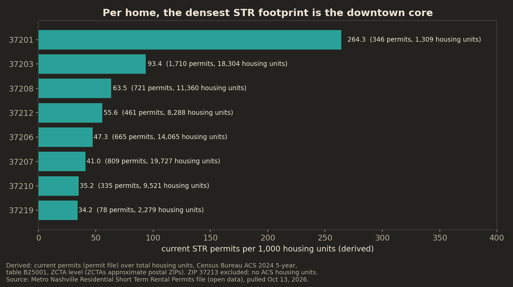

# Half of Nashville's Investor STR Permits Are Owned From Outside the County

*Every short-term rental permit record Metro Nashville has published since 2015 (17,612 records, pulled October 13, 2026), and the question underneath the city's short-term rental fight: when a Nashville home becomes a hotel, who owns the hotel?*

## The bottom line

Nashville has **7,017 short-term rental permits in force today** (permit status ISSUED in Metro's public file; none of them carries an expiration date before the pull date). This is not mostly neighbors renting out a spare room. **71.4% of current permits (5,011) are not owner occupied.** Only 2,006 (28.6%) are owner occupied.

And the investor stock is substantially remote. Of the current not-owner-occupied permits, **49.9% have an owner mailing address outside Davidson County, and 40.4% (2,018 permits) have an owner mailing address in another state** (derived; method below). The two largest permit holders in the city hold 617 current permits between them, and they mail from Miami and San Francisco.

## Finding 1: The legal STR market is an investor market

Metro Nashville issues two classes of residential STR permit: owner occupied, where the owner lives at the property, and not owner occupied, where they do not. Among permits in force today the split is not close: 5,011 not owner occupied against 2,006 owner occupied.

The 17,612-record file is a decade of flow, not a snapshot. Permits run one year, so most records have expired (8,024 records) or been cancelled (2,266). First issuances peaked in 2018 (2,181) and again in 2022 (2,106), but neither peak is a market-wide rush. Remove Bop Nest Nashville's 327 permits, issued in November and December 2018 as one portfolio came onto the register, and 2018 falls to 1,854, below 2019 (1,993). Remove Sixth South Partners' 297 permits from 2022 and that year falls to 1,809, also below 2019.

The one sharp policy fingerprint in the trend runs the other way. Investor issuance hit 200 in December 2017, the highest month of that year and well above the next-highest month (113), weeks before the Metro Council voted in January 2018 to ban new non-owner-occupied permits in residential zones and phase out existing ones over three years. A single apartment building, 505 Apartments, accounts for 125 of those December permits. In April 2018 the state legislature reversed the phase-out: Tennessee's Short-Term Rental Unit Act grandfathered the permits already issued. The current stock of 7,017 is what survived that churn as of the pull date.

## Finding 2: Half the investor permits are owned from outside the county

For each permit, Metro records the owner's mailing address separately from the property address. Testing the mailing ZIP against the property ZIP codes in the file (and the mailing state on its own) splits the current investor stock almost exactly in half (derived):

- **50.1%** of current not-owner-occupied permits have an owner mailing address inside the Davidson County ZIP footprint
- **9.5%** mail from elsewhere in Tennessee (Franklin and Murfreesboro are the largest sources)
- **40.4%** mail from out of state

The biggest out-of-state sources are California (578 current permits across all classes) and Florida (400). Only 14.2% of investor permits have an owner mailing ZIP identical to the property's ZIP.

The control group is built into the same file. Owner-occupied permits, where the owner by definition lives at the property, come back **98.5% inside the county footprint and 0.8% out of state**. The mailing-address signal behaves exactly as it should where the answer is known, which is what makes the investor split worth believing.

## Finding 3: Two out-of-state holders run one in eight investor permits

Current permits name 4,696 distinct owners (derived; names normalized, see methods). Most are small: 90.5% hold exactly one permit. The tail is not small. **47 owners, 1.0% of the total, hold 10 or more permits each, and together they hold 1,569 current permits, 22.4% of the entire current stock.**

The top of the list is not local:

- **Bop Nest Nashville** holds 328 current permits, all not owner occupied, owner mailing address in Miami, Florida
- **Sixth South Partners** holds 289 current permits, all not owner occupied, owner mailing address in San Francisco, California

Together that is 617 permits: 8.8% of every current STR permit in Nashville, and 12.3% of the investor stock. Both portfolios are spread across hundreds of individual addresses (326 and 289 distinct address strings), mostly individual condo and apartment units rather than a single building each. At the parcel level, 34 parcels hold 10 or more permits apiece, accounting for 1,319 current permits (18.8%): the condo-building layer of the market.

## Finding 4: The investor stock is condos and apartments, not houses

The permit file alone cannot say what kind of housing these permits occupy, so this brief joined it to the county assessor's parcel file (land use, matched on parcel number for 7,000 of the 7,017 current permits). The split is not close. Of the 4,998 current investor permits the join matched, **only 5.2% (260) sit on parcels the assessor classifies as single-family**. Condos account for 51.0% (2,547) and apartment or other multifamily parcels for 27.4% (1,367). The assessor confirms the top of Finding 3 as well: every one of the 617 permits held by Bop Nest Nashville and Sixth South Partners sits on a parcel classified as a high-rise apartment (3 stories or greater).

The owner-occupied class inverts the picture: 76.5% of its permits are on single-family parcels. Whatever Nashville's STR fight is about in 2026, on the investor side it is mostly a fight about units in buildings, not houses leaving neighborhoods. The remaining investor permits sit on parcels the assessor carries as vacant land (5.8%), commercial or miscellaneous uses, or with no land-use description recorded (5.4%): lags and gaps in the assessor's file that this brief reports rather than explains away.

## Finding 5: The map is tight

Current permits cluster hard. ZIP code **37203** (downtown and the Gulch) alone holds 1,710 current permits, 24.4% of the citywide stock. The top five ZIP codes (37203, 37207, 37208, 37206, 37212) hold **62.2%**. Council District 19 holds 1,889 current permits (26.9%), and the top four districts hold 62.9%. Whatever Nashville decides about short-term rentals, it is deciding about a handful of neighborhoods, not a citywide sprinkle.

Measured against the housing stock instead of raw counts, the map sharpens rather than flattens (derived). ZIP **37201**, the downtown core, holds just 346 current permits but only 1,309 housing units in the Census Bureau's ACS 2024 5-year estimates: **264 permits per 1,000 housing units, roughly one permit for every four homes**. The Gulch's 37203 runs 93 per 1,000. The second-largest ZIP by count, 37207 (809 permits), thins to 41 per 1,000 because it holds far more housing. Citywide, the rate is 16.8 permits per 1,000 housing units.

## What this does not prove

This file counts permits, not rentals. It cannot see unpermitted listings, which by definition leave no record here; it cannot see nights booked, revenue, or guests. Nothing in it measures noise, housing prices, or whether any given permit is actually in use this month.

An owner mailing address is where an owner receives mail. It is not proof of where the owner lives, votes, or keeps the profits, and a Nashville mailing address can belong to a property manager or a registered agent rather than the beneficial owner. Read the out-of-area figures as the geography of where permit paperwork points, which is the strongest ownership signal the public file contains, not as a census of who profits.

The permit file by itself also cannot split the investor stock into single-family houses versus multifamily units. It records not-owner-occupied permits under two codes from two eras of the permitting system (one dominant in 2015-2016 and gone by 2024, one dominant since), so this brief merges them into a single not-owner-occupied class and claims no house-versus-condo split from the permit type field. The split in Finding 4 comes from the assessor join instead, and it carries that file's limits: land-use descriptions lag new construction, 17 current permits matched no assessor parcel, and 279 current permits sit on matched parcels that carry no land-use description.

## Methods

The core dataset is Metro Nashville's Residential Short Term Rental Permits file, served from the city's open data portal (ArcGIS Feature Service, item b5315bda43ac459281dd35f04aa1be32). Pulled in full on October 13, 2026: 17,612 records, every record the service holds, fields as published. The historical Socrata copy of this dataset (2z82-v8pm) no longer resolves; the ArcGIS service is the current endpoint and is what this brief used. Applicant and contact phone-number columns were dropped from the saved copy and never used. Two further public sources are layered onto it for Findings 4 and 5: the Davidson County assessor's parcel file and the Census Bureau's ACS housing-unit estimates, each described below.

**Current permits** are records with permit status ISSUED. Verified at pull time: every ISSUED record carries an expiration date on or after the pull date (3 of the 7,017 expire on the pull date itself), so the ISSUED set is the live permit stock, not a lagging snapshot. Other statuses (EXPIRED 8,024; CANCELLED 2,266; REVOKED 164; DENIED-D 38; PENDING 37; a long tail of 66) are treated as history. Two integrity notes from verification: 10 permit numbers appear twice inside the ISSUED set with identical address, parcel, owner, and class, apparent duplicate records of the same permit; counting each once gives 7,007 current permits, and no share in this brief moves by more than 0.1 percentage points. A further 42 records sit in an EXPIREEXT status (expired, in extension) and all carry expiration dates after the pull date; treating them as live would give 7,059 current permits and move no headline share by more than 0.2 points.

**Permit class** comes from the permit subtype field: CAZ10A001 is owner occupied; CAZ10A002 and CAZ10A003 are the not-owner-occupied codes from successive eras of the system and are merged (see "What this does not prove").

**Out-of-area ownership (derived)** uses only the owner mailing fields (owner city, state, ZIP), never the property address. Out of state: normalized owner state is not TN, computed over the 4,999 current not-owner-occupied records with owner geography present (2,018 records, 40.4%). Outside the county footprint: the owner's 5-digit mailing ZIP does not appear among the property ZIP codes present in the file (every record is a Davidson County property, so that set is the county footprint as the file itself draws it), computed over 4,996 records with a usable mailing ZIP (2,493 records, 49.9%). ZIP codes are postal geographies, not county lines: a few straddle the boundary, and 47 current permits carry Nashville mailing addresses whose ZIPs (mostly P.O. box and institutional ZIPs) fall outside the property ZIP set. The owner-occupied class serves as the control: the same method returns 98.5% inside the footprint for it. A stricter test built on Census Bureau geography, in which a mailing ZIP counts as inside the county only when most of its land area lies in Davidson County, pushes the investor outside share up to 57.0%, because several ZIP codes in the file's footprint (37064 Franklin, 37122 Mt. Juliet, 37027 Brentwood) lie mostly outside the county. On that test the brief's 49.9% is a floor rather than an overstatement, and the control class still returns 98.0% inside.

**Owner concentration (derived)** groups records by the permit owner name, normalized by uppercasing, removing punctuation, collapsing whitespace, and stripping trailing legal suffixes (LLC, INC, CORP, and similar). Name variants can still split one real owner into two entries, so concentration figures are floors, not exact counts. 13 records in the full file have no owner name and are excluded from concentration math; every current permit carries one. Verification re-ran the concentration under looser (raw names) and stricter (also stripping ET AL and trailing THE) normalizations: the 47-owner and 22.4% figures do not move.

**Property type (derived)** joins current permits to the Davidson County assessor's parcel file (Parcels view, Metro Nashville open data) on the parcel number the permit file carries (STANPAR in the assessor file). 5,464 of 5,472 distinct current parcels matched, covering 7,000 of 7,017 current permits (99.8%). Buckets follow the assessor's land-use description: RESIDENTIAL CONDO and the commercial condo descriptions count as condo; SINGLE FAMILY as single-family; APARTMENT, DUPLEX, TRIPLEX, and QUADPLEX descriptions as apartment or multifamily; everything else is reported as recorded, not forced into a bucket.

**Density (derived)** divides current permits in each property ZIP by total housing units from the U.S. Census Bureau's ACS 2024 5-year estimates (table B25001), pulled from the Census summary file because the Census API now requires a key. Postal ZIPs are matched to Census ZCTAs, which approximate ZIP boundaries; ZIP 37213 has no ACS housing units and is excluded from the density table. The policy dates in Finding 1 come from the text of Ordinance BL2014-951 (Metro legisarchive) and Associated Press reporting on the January 2018 council vote and the April 2018 Short-Term Rental Unit Act (Tenn. Code Ann. 13-7-601 et seq.); the December 2017 and portfolio figures come from the permit file's own monthly issuance counts.

Analysis in Python (pandas/matplotlib); the download script, analysis script, aggregated statistics, and per-figure source audit are in this repo.
